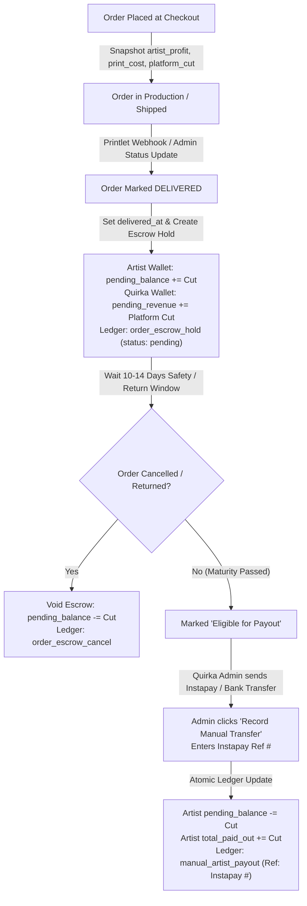

# Implementation Plan: Artist Wallet & Micro-Ledger System with Escrow Clearance & Printlet Remittances

## Goal Description
Implement an auditable, thread-safe **Wallet & Micro-Ledger System** for Quirka that:
1. Automatically records each artist's cut (`artist_profit × quantity`) into their **Pending Balance** when an order is delivered.
2. Tracks the **10–14 days clearance holding period** before pending earnings become eligible for payout.
3. Supports **Manual Payout Transfers** from Quirka to artists (via Instapay / Vodafone Cash / Bank Transfer), deducting from the artist's pending balance and logging an immutable transaction with payment reference numbers.
4. Manages a **Quirka Platform Wallet** to track platform net profit (`platform_cut + platform_fixed_fee`).
5. Tracks **Printlet COD Remittances** (customer cash collected by Printlet delivery couriers vs. net funds remitted to Quirka's bank account).

This builds directly on the three-party pricing model defined in [`docs/PLAN-pricing-strategy.md`](file:///home/mohamed/Documents/SE/Quirka/docs/PLAN-pricing-strategy.md) where `order_items` snapshots `artist_profit`, `print_cost`, `platform_cut`, and `artist_id`.



---

## The Multi-Wallet Architecture

```
                     [ Customer Payment (1,000 EGP) ]
                                       │
            ┌──────────────────────────┴──────────────────────────┐
            ▼ (Prepaid: Instapay)                                 ▼ (COD: Doorstep Cash)
   [ Quirka Bank / Instapay ]                              [ Printlet Courier Fleet ]
            │                                                     │
            │                                                     │ (Printlet nets print_cost)
            │                                                     ▼
            │                                     [ Printlet Remittance to Quirka ]
            └──────────────────────────┬──────────────────────────┘
                                       │
                                       ▼
                       [ Quirka System Treasury ]
            ┌──────────────────────────┴──────────────────────────┐
            ▼                                                     ▼
 [ Quirka Platform Wallet ]                             [ Artist Wallet ]
 • Realized Platform Profit                             • Pending Balance (Holding 10-14d)
 • (platform_cut + fixed_fee)                           • Becomes Eligible for Payout
 • Track operating withdrawals                          • Paid via Manual Instapay Transfer
```

---

## Proposed Database Schema

### 1. `wallets` Table
- `id`: bigIncrements
- `user_id`: foreignId nullable constrained to `users` cascade (null for Quirka Platform Wallet)
- `type`: `string` default `'artist'` (`artist`, `platform`)
- `balance`: `decimal(12, 2)` unsigned default `0.00` (available / realized balance)
- `pending_balance`: `decimal(12, 2)` unsigned default `0.00` (funds currently in holding or awaiting manual payout)
- `total_paid_out`: `decimal(12, 2)` unsigned default `0.00` (lifetime paid out to artist)
- `currency`: `string(3)` default `'EGP'`
- `payout_method`: `string` nullable (`instapay`, `vodafone_cash`, `bank_transfer`)
- `payout_details`: `json` nullable (e.g. `{"instapay_handle": "user@instapay", "phone": "010...", "iban": "..."}`)
- `timestamps`

### 2. `wallet_transactions` Table (Micro-Ledger)
- `id`: bigIncrements
- `wallet_id`: foreignId constrained to `wallets` cascade
- `type`: `string` (`credit`, `debit`)
- `category`: `string`:
  - `order_escrow_hold` (created on delivery into pending_balance)
  - `manual_artist_payout` (admin manual transfer via Instapay, moves from pending_balance to paid_out)
  - `order_escrow_cancel` (order returned/cancelled, pending_balance voided)
  - `platform_fee_collected` (Quirka net revenue cleared)
  - `admin_adjustment` (audit adjustment)
- `amount`: `decimal(12, 2)`
- `balance_before`: `decimal(12, 2)`
- `balance_after`: `decimal(12, 2)`
- `pending_balance_before`: `decimal(12, 2)`
- `pending_balance_after`: `decimal(12, 2)`
- `status`: `string` (`pending`, `cleared`, `cancelled`, `completed`)
- `reference_type`: `string` nullable (`App\Models\Order`)
- `reference_id`: `unsignedBigInteger` nullable
- `transfer_reference`: `string` nullable (Instapay transaction ID, bank reference, etc.)
- `transferred_by`: `foreignId` nullable constrained to `users` (admin who made the manual payout)
- `hold_until`: `timestamp` nullable (10–14 days maturity date)
- `cleared_at`: `timestamp` nullable
- `description`: `string`
- `metadata`: `json` nullable
- `timestamps`

### 3. `printlet_remittances` Table (COD Settlement Tracker)
- `id`: bigIncrements
- `amount`: `decimal(12, 2)` (amount transferred from Printlet to Quirka bank)
- `remittance_date`: `date`
- `reference_number`: `string` (Printlet settlement ID / bank deposit ref)
- `status`: `string` default `'received'` (`pending`, `received`, `disputed`)
- `notes`: `text` nullable
- `recorded_by`: `foreignId` constrained to `users` (admin)
- `timestamps`

### 4. `orders` Table Modification
- `delivered_at`: timestamp nullable (set when order status reaches `delivered` or `completed`)

### 5. `pricing_settings` Table Modification
- `payout_holding_days`: integer default `14` (configurable 10 to 30 days)

---

## Core Services & Workflows

### `App\Services\WalletService`
1. `holdOrderEarnings(Order $order): void`
   - Groups order items by `artist_id`.
   - Idempotently creates `order_escrow_hold` for each artist with `hold_until = $order->delivered_at->addDays($holdingDays)`.
   - Increases artist's `$wallet->pending_balance`.
   - Records pending cut for Quirka Platform Wallet.
2. `cancelOrderEscrow(Order $order): void`
   - If an order is cancelled or refunded before payout, voids pending transactions and decrements `pending_balance`.
3. `recordManualArtistPayout(Wallet $wallet, float $amount, string $transferReference, User $admin, array $orderIds = [], ?string $notes = null): WalletTransaction`
   - Atomically locks `$wallet` (`lockForUpdate()`).
   - Decrements `$wallet->pending_balance` by `$amount`.
   - Increments `$wallet->total_paid_out` by `$amount`.
   - Creates `manual_artist_payout` ledger transaction storing `$transferReference` and `$admin->id`.
   - Updates corresponding order holds to `cleared`.
4. `recordPrintletRemittance(float $amount, string $referenceNumber, string $date, ?string $notes, User $admin): PrintletRemittance`
   - Logs incoming COD settlement from Printlet into Quirka's bank account.

---

## User Interfaces

### 1. Artist Wallet Dashboard (`/artist/wallet`)
- **Pending Balance** card (highlighting amount clearing vs. amount eligible for payout).
- **Total Paid Out to Date** card.
- **Payout Details Configuration** form (Instapay handle, Vodafone Cash, Bank Account IBAN).
- **Ledger History Table**:
  - Date, Order #, Type, Amount (EGP), Status (`Holding in Escrow`, `Eligible for Payout`, `Transferred via Instapay`), Transfer Reference #.

### 2. Admin Wallets & Payouts Screen (`/admin/wallets`)
- **Overview KPIs**:
  - Total Escrowed Artist Funds
  - Total Paid Out to Artists Lifetime
  - Quirka Platform Net Profit Realized
  - Pending COD Cash at Printlet (Expected vs Remitted)
- **Pending Payouts Action Table**:
  - Artists with earnings where `hold_until <= now()`.
  - Shows Artist Name, Instapay Handle / Bank Info, Eligible Amount, Linked Orders.
  - Interactive Modal: **"Record Manual Transfer"** (inputs: Transfer Amount, Instapay Ref #, Transfer Date, Notes).
- **Printlet Remittances Tab**:
  - Form to record new Printlet remittance deposits.
  - History of Printlet settlements.

---

## Verification Plan
1. **Migrations:** Run migrate and rollback test.
2. **Order Delivery Hook:** Verify delivered order creates escrow hold on artist wallet with 14-day `hold_until`.
3. **Manual Transfer Execution:** Verify recording manual transfer deducts pending balance, increments total paid out, and persists Instapay reference.
4. **Printlet Remittance:** Verify recording Printlet remittances tracks COD expected vs received.
5. **Lint & Pint:** Format code to adhere to Quirka standards.
